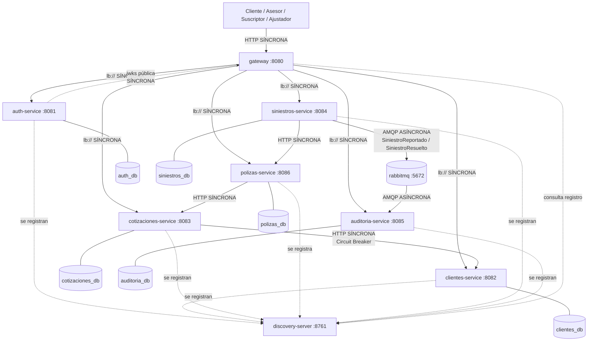

# Arquitectura de la Aseguradora Digital

**Proyecto G5 · Ingeniería de Software II · UPTC**
**Documento de la Lección 12** — describe el sistema **tal como está construido**.
**Fecha:** 2026-11-22 (corte del proyecto)

---

## 1. Contexto y motivadores

Plataforma para cotizar seguros, emitir pólizas y gestionar el reporte y seguimiento de
siniestros, con reglas propias de suscripción y evaluación de riesgo. Los actores son el
cliente, el asesor comercial, el suscriptor y el ajustador de siniestros.

La compañía vende protección: primero **cotiza** un riesgo y calcula una prima; después
**emite una póliza**, que es el contrato; y cuando ocurre un daño, **gestiona un siniestro**,
que es el reclamo. Esas son las tres capacidades del negocio y, en el software, los tres
contextos delimitados del sistema.

**Atributos de calidad, ordenados:**

1. **Control del dato** — la evaluación de un siniestro debe basarse en la póliza de
   registro, no en lo que declare el cliente. Escenario: 0 siniestros aprobados sobre
   pólizas canceladas en una batería de 100 casos.
2. **Auditabilidad** — toda decisión sobre una póliza o un siniestro queda registrada con
   quién, cuándo y con qué datos. Escenario: 100 % de las decisiones trazables con
   `siniestroId`, estado y monto; consultables por HTTP.
3. **Disponibilidad de la cotización** — un fallo en reclamos no debe impedir cotizar.
   Escenario: con `siniestros-service` detenido, `POST /api/cotizaciones` responde 201 en
   p95 < 500 ms.
4. **Modificabilidad de las reglas de riesgo** — cambiar el umbral de revisión manual no
   debe tocar los otros dos contextos. Medida: un solo paquete tocado.
5. **Seguridad de datos personales y financieros** — toda petición autenticada con JWT
   firmado por el servicio de identidad.

---

## 2. Estilos y patrones por componente

| Componente | Estilo / patrón | Almacén de datos | Comunicación | Atributo que sirve |
|---|---|---|---|---|
| `gateway` | API Gateway (Spring Cloud Gateway) | — | HTTP saliente a los servicios, descubiertos por Eureka | Seguridad (5) |
| `discovery-server` | Service registry (Eureka) | — | Registro y descubrimiento | Disponibilidad (3) |
| `auth-service` | Servicio de identidad, JWT RS256 | PostgreSQL `auth_db` | HTTP; servicio de validación del resto | Seguridad (5) |
| `clientes-service` | Hexagonal + DDD | PostgreSQL `clientes_db` | HTTP; servicio de consulta de Cotizaciones | Modificabilidad (4) |
| `cotizaciones-service` | Hexagonal + DDD + Circuit Breaker | PostgreSQL `cotizaciones_db` | HTTP síncrona a `clientes-service` | Disponibilidad (3) |
| `polizas-service` | Hexagonal + DDD | PostgreSQL `polizas_db` | HTTP síncrona a Cotizaciones; consulta desde Siniestros | Control del dato (1) |
| `siniestros-service` | Hexagonal + DDD + **publicador de eventos** | PostgreSQL `siniestros_db` | REST entrante; HTTP síncrona a Pólizas; **asíncrona saliente** a RabbitMQ | Control del dato (1) |
| `auditoria-service` | **Consumidor idempotente** (event-driven) | PostgreSQL `auditoria_db` | **Asíncrona entrante** desde RabbitMQ | Auditabilidad (2) |
| RabbitMQ | Message broker (topic exchange) | — | AMQP 0-9-1 | Auditabilidad (2) |

**Prueba de necesidad, fila por fila:**

- *API Gateway*: resuelve un problema concreto — el cliente no debe conocer los puertos ni
los nombres de los servicios, y la validación del token se hace en un solo punto.
- *Eureka*: sin descubrimiento, cada servicio tendría las URLs de los demás fijas y un
  cambio de puerto rompería el sistema entero.
- *Hexagonal en cada contexto*: permite probar las reglas de negocio sin Spring ni base de
  datos. Es lo que hace posible 160 pruebas rápidas.
- *Circuit Breaker en Cotizaciones*: sin él, un `clientes-service` lento agota los hilos de
  Cotizaciones y tumba la cotización completa. Resuelve el atributo 3.
- *Mensajería asíncrona hacia Auditoría*: resuelve que la trazabilidad **no** puede costar
  disponibilidad en el camino crítico del ajustador. Ver ADR P-06.
- *Base de datos por servicio*: cada contexto evoluciona su esquema sin romper al otro.
- **No hay** Kafka, service mesh, CQRS ni observabilidad distribuida: su incorporación se
  justifica como propuesta en los ADR P-01 y P-05, y en §8.

**Nota de alcance:** el curso evalúa el código hasta la Lección 6. Las piezas de L8–L11
(CQRS, EDA completa, observabilidad, contenedores de aplicación y CI/CD) aparecen en este
documento **solo como propuestas**, y así están marcadas.

---

## 3. Diagrama de contenedores (C4)

Todas las cajas de servicios corresponden a carpetas reales del repositorio.



**Clasificación de las conexiones:**

| Conexión | Tipo | Por qué |
|---|---|---|
| Actor → Gateway | **Síncrona** | El usuario espera la respuesta de su operación |
| Gateway → cada servicio | **Síncrona** | Es un proxy de entrada: reenvía y devuelve la respuesta |
| Gateway → `auth-service` (jwks) | **Síncrona** | La clave pública se necesita para validar el token antes de dejar pasar la petición |
| Cotizaciones → Clientes | **Síncrona** | Se necesita saber *ya* si el cliente existe para no crear una cotización huérfana; protegida con Circuit Breaker y timeout |
| Pólizas → Cotizaciones | **Síncrona** | Solo se emite sobre una cotización aceptada; el servicio valida el dato en la fuente de verdad |
| Siniestros → Pólizas | **Síncrona** | El valor asegurado y el estado de la póliza vienen del registro, no del request del cliente |
| **Siniestros → Auditoría** | **Asíncrona** | Es propagación de un hecho, no una consulta: la decisión del ajustador no debe esperar a que se escriba la auditoría, ni fallar si la auditoría está caída |
| Servicios → Eureka | Síncrona (heartbeat) | Es registro y descubrimiento, no lógica de negocio |

**Cadenas síncronas:** Actor → Gateway → Cotizaciones → Clientes y Actor → Gateway →
Siniestros → Pólizas son cadenas de **tres saltos**. Cotizaciones → Clientes está acotada con
`CircuitBreaker`, `connectTimeout` de 2 s y `readTimeout` de 3 s. Las llamadas nuevas a
Pólizas usan Eureka y propagan el JWT del request.

---

## 4. Decisiones (ADR)

Los siete ADR están en `docs/adr/`. Cada uno nombra alternativa descartada y consecuencias
negativas.

| ADR | Decisión | Estado | Alternativa descartada | Consecuencia negativa aceptada |
|---|---|---|---|---|
| **P-01** | Siniestros consulta la póliza vía puerto, no confía en el cliente | **Aceptado — implementado** | Seguir recibiendo el estado en el request | Una llamada más en el camino crítico y un modo de fallo nuevo |
| **P-02** | Extraer solo `siniestros-service` como fase 1 | **Aceptado** — fase 1 implementada (ver P-07) | Extraer los tres contextos a la vez | Consistencia eventual, una base y un despliegue más |
| **P-03** | Puertos y adaptadores entre contextos | Aceptado | Importar el caso de uso de Cotización directamente | Una interfaz y una traducción por cada comunicación |
| **P-04** | Monolito modular antes que microservicios | Aceptado (superado por P-07 en Siniestros) | Distribuir todo desde el inicio | Un cambio obliga a redesplegar todo; no se escala solo reclamos |
| **P-05** | CQRS para el histórico de siniestros | **Propuesta** — no implementado | Consultar los dos contextos en cada request | Consistencia eventual y un modelo más que mantener |
| **P-06** | RabbitMQ para la auditoría asíncrona | **Aceptado** — implementado | Auditoría por llamada REST síncrona | Un bróker más que operar y consistencia eventual visible |
| **P-07** | Extraer Siniestros a servicio propio | **Aceptado** — implementado | Mantener los tres contextos en un proceso | Una base, un despliegue y un puerto más; llamadas entre contextos por red |

---

## 5. Fitness functions

| # | Regla | Qué protege | Herramienta | Estado |
|---|---|---|---|---|
| **F1** | El dominio no depende de la infraestructura | El hexágono de cada contexto | ArchUnit | Propuesta |
| **F2** | Ningún contexto importa la infraestructura de otro | Las fronteras entre contextos (ADR P-03) | Compilación Maven + ArchUnit | **Cumplida por construcción** en los servicios extraídos: son proyectos separados y un import cruzado no compila |
| **F3** | La evaluación de un siniestro no acepta el estado ni el valor asegurado del cliente | El riesgo R1 del ATAM (ADR P-01) | Pruebas de aplicación y controlador | **Implementada** |
| **F4** | El consumidor de auditoría es idempotente | Que un reenvío no duplique el histórico | Prueba con el mismo `mensajeId` dos veces | **Implementada**: `AuditoriaServiceTest.elMismoMensajeDosVecesSoloSeAuditaUnaVez` |
| **F5** | El gateway enruta Pólizas por Eureka | Que el gateway no dependa de un puerto fijo o del monolito | Prueba sobre `RouteLocator` | **Implementada**: `RutasGatewayTest.polizasSeEnrutaAlServicioDescubiertoPorEureka` |

Las pruebas F4 y F5 corren en cada `mvnw test`, así que la regla se verifica sola.

---

## 6. Mesh: ¿lo necesitamos?

**Service mesh: no.** Los números: **8 procesos desplegables**, un equipo de **3 personas** y
un único entorno de ejecución en el curso. Un mesh (Istio, Linkerd) existe para gestionar
tráfico entre decenas de servicios con equipos distintos y requisitos uniformes de seguridad y
resiliencia; aquí el gateway ya centraliza la autenticación y la resiliencia se resuelve en el
punto donde importa (Circuit Breaker entre Cotizaciones y Clientes). Sería infraestructura para
un problema que el sistema no tiene.

**Data mesh: no.** Requiere múltiples dominios con equipos de datos propios y un cuello de
botella central de analítica. Este proyecto tiene tres contextos y un equipo; la analítica que
pide la HU-10 se resuelve con una consulta sobre `auditoria_db`, no con una plataforma de datos.

**Cuándo cambiaría la respuesta:** si el sistema llegara a decenas de servicios con varios
equipos, y si existiera una necesidad de analítica transversal a muchos sistemas de la
compañía. Ninguna de las dos condiciones se cumple.

---

## 7. Riesgos y deuda conocida

| # | Riesgo o deuda | Impacto | Qué se haría si se materializa |
|---|---|---|---|
| **1** | **Pólizas/Cotizaciones/Siniestros dependen de la disponibilidad de sus consultas HTTP síncronas.** | Un servicio no disponible puede impedir emitir o evaluar un siniestro | Propagar errores explícitamente y añadir timeout/circuit breaker si las métricas lo justifican |
| **2** | ~~Pólizas en H2 en memoria~~ | **Cerrado**: `polizas-service` usa PostgreSQL `polizas_db` y Flyway |
| **3** | **El código de `digital-insurance-api` sigue duplicado en el repositorio.** | Confusión sobre cuál servicio es fuente de verdad | Retirar la carpeta heredada después de validar los flujos por Gateway |
| **4** | **El contrato de `EventoSiniestro` está duplicado** en productor y consumidor. | Un cambio incompatible rompe la auditoría sin fallar en compilación | Extraer un módulo compartido o publicar un esquema versionado |
| **5** | **No hay pruebas de arquitectura.** | El hexágono puede erosionarse sin que el build lo note | F1 y F3 con ArchUnit |
| **6** | ~~La ruta de Pólizas apunta al monolito~~ | **Cerrado**: Gateway usa `lb://polizas-service` y el servicio se registra en Eureka |

##### Deudas cerradas en este corte

Las siguientes estaban registradas y ya no aplican:

- ~~No hay auditoría persistente~~ → **cerrada** con `auditoria-service` y RabbitMQ (P-06).
- ~~Los datos de Siniestros se pierden al reiniciar~~ → **cerrada** con `siniestros_db` (P-07).
- ~~Un solo proceso para tres capacidades~~ → **cerrada en ejecución**: Clientes, Cotizaciones,
  Pólizas y Siniestros tienen servicios independientes; el monolito permanece solo como código
  heredado pendiente de retirar.

---

## 8. Lo que se decidió no construir

Una ausencia justificada es una decisión de arquitectura, no una omisión:

| Tecnología | Decisión | Razón |
|---|---|---|
| Service mesh | No | 8 procesos, 1 entorno, 3 personas |
| Data mesh | No | Sin equipos de datos por dominio ni cuello de botella de analítica |
| Kubernetes | No en este alcance | Docker Compose cubre la necesidad del curso |
| Event Sourcing | No | El estado actual es la fuente de verdad; el historial completo no es requisito |
| Kafka | No en este alcance | No hace falta reprocesar histórico ni varios consumidores; ver P-06 |
| CQRS | No — **propuesta** | Diseñado en P-05; requiere mensajería madura y un modelo de lectura propio |
| Observabilidad distribuida | No — **propuesta** | Requiere trazas entre servicios (L10); hoy hay logs por servicio |
| Nanoservicios | No | Un servicio por entidad sería un error de granularidad |

---

## 9. Revisión cruzada

Pendiente para la sesión del 24 de noviembre. Lista de verificación de la guía:

```
[x] Los atributos de calidad están ordenados y tienen escenario medible
[x] Cada fila de la tabla nombra el atributo que sirve
[x] No hay un estilo sin problema concreto que lo justifique
[x] El diagrama tiene flechas etiquetadas (tecnología y síncrona/asíncrona)
[x] No hay cadenas síncronas largas sin comentario
[x] Cada ADR tiene alternativa descartada y consecuencias negativas
[x] La decisión sobre mesh está justificada con números
[x] Hay al menos 2 fitness functions verificables (hay 5, dos implementadas)
[x] Hay riesgos y deuda reconocidos (6)
[x] Una persona externa podría entender el documento en 10 minutos
```
