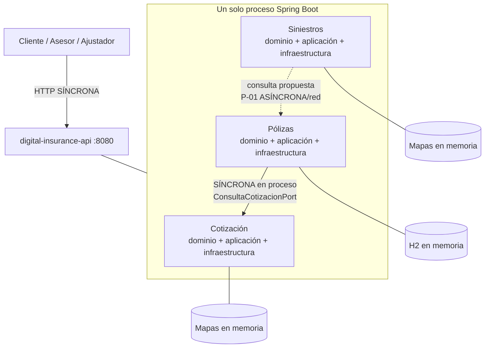

# Arquitectura de la Aseguradora Digital

**Proyecto G5 · Ingeniería de Software II · UPTC**
**Documento de la Lección 12** — describe el sistema **tal como está construido**.
**Fecha:** 2026-11-16

---

## 1. Contexto y motivadores

Plataforma para cotizar seguros, emitir pólizas y gestionar el reporte y seguimiento de
siniestros, con reglas propias de suscripción y evaluación de riesgo. Los actores son el
cliente, el asesor comercial, el suscriptor y el ajustador de siniestros.

La compañía vende protección: primero **cotiza** un riesgo y calcula una prima; después
**emite una póliza**, que es el contrato; y cuando ocurre un daño, **gestiona un siniestro**,
que es el reclamo. Esas son las tres capacidades del negocio y, en el software, los tres
contextos delimitados del sistema.

**Atributos de calidad, ordenados:**

1. **Control del dato** — la evaluación de un siniestro debe basarse en la póliza de
   registro, no en lo que declare el cliente. Escenario: 0 siniestros aprobados sobre
   pólizas canceladas en una batería de 100 casos.
2. **Auditabilidad** — toda decisión sobre una póliza o un siniestro queda registrada con
   quién, cuándo y con qué datos.
3. **Disponibilidad de la cotización** — un fallo en reclamos no debe impedir cotizar.
   Escenario: con Siniestros detenido, `POST /api/cotizaciones` responde 201 en p95 < 500 ms.
4. **Modificabilidad de las reglas de riesgo** — cambiar el umbral de revisión manual no
   debe tocar los otros dos contextos.
5. **Seguridad de datos personales y financieros.**

---

## 2. Estilos y patrones por componente

| Componente | Estilo / patrón | Almacén de datos | Comunicación | Atributo que sirve |
|---|---|---|---|---|
| `cotizacion` | Hexagonal + DDD | Mapas en memoria (**deuda**) | En proceso; expone REST `/api/cotizaciones` | Modificabilidad de reglas (4) |
| `poliza` | Hexagonal + DDD | H2 en memoria vía JPA (**deuda**) | En proceso; expone REST `/api/polizas` | Auditabilidad (2) |
| `siniestros` | Hexagonal + DDD | Mapas en memoria (**deuda**) | En proceso; expone REST `/api/siniestros` | Control del dato (1) |
| Pólizas → Cotización | Puerto y adaptador | — | **Síncrona en proceso** (`ConsultaCotizacionPort`) | Modificabilidad (4) |

**Prueba de necesidad, fila por fila:**

- *Monolito modular* (el contenedor de los tres): resuelve el costo de operación de un
  equipo de tres personas y conserva las transacciones locales que el dominio necesita.
- *Hexagonal dentro de cada contexto*: permite probar las reglas de negocio sin Spring ni
  base de datos. Es lo que hace posible 115 pruebas rápidas.
- *Puertos y adaptadores entre contextos*: Pólizas necesita datos de Cotización sin
  acoplarse a su implementación; el puerto permite sustituir la fuente sin tocar el dominio.
- **No hay** microservicios, mensajería, gateway ni descubrimiento: ninguno resuelve hoy un
  problema que el equipo tenga. Su incorporación está justificada como propuesta en los ADR
  P-01, P-02 y P-05.

**Nota de alcance:** el curso evalúa el código hasta la Lección 6. Las piezas de L8–L11
aparecen en este documento **solo como propuestas**, y así están marcadas.

---

## 3. Diagrama de contenedores (C4)



**Clasificación de las conexiones:**

| Conexión | Tipo | Por qué |
|---|---|---|
| Cliente → API | **Síncrona** | El usuario espera la respuesta de su operación |
| Pólizas → Cotización | **Síncrona en proceso** | Necesita los datos de la cotización para emitir; hoy es una llamada Java, no de red |
| Siniestros → Pólizas (P-01) | **Síncrona propuesta** | Es una validación previa: no se evalúa el siniestro sin conocer el estado real de la póliza |
| Siniestros → auditoría (P-05, L9) | **Asíncrona propuesta** | Es propagación de un hecho; no se necesita la respuesta para continuar |

**Cadenas síncronas:** la más larga hoy es de **un salto dentro del mismo proceso**. Si se
implementara P-01, pasaría a ser cliente → Siniestros → Pólizas: dos saltos, dentro del
límite recomendado. **No hay ninguna cadena de tres o más saltos síncronos**, que es la
señal de monolito distribuido.

---

## 4. Decisiones (ADR)

Los cinco ADR del proyecto están en `docs/adr/`. Todos nombran alternativa descartada y
consecuencias negativas.

| ADR | Decisión | Estado | Alternativa descartada | Consecuencia negativa aceptada |
|---|---|---|---|---|
| **P-01** | Siniestros consulta la póliza vía puerto, no confía en el cliente | **Propuesta** | Seguir recibiendo el estado en el request | Una llamada más en el camino crítico y un modo de fallo nuevo |
| **P-02** | Extraer solo `siniestros-service` como fase 1 | **Propuesta** | Extraer los tres contextos a la vez | Consistencia eventual, una base y un despliegue más |
| **P-03** | Puertos y adaptadores entre contextos | Aceptado | Importar el caso de uso de Cotización directamente | Una interfaz y una traducción por cada comunicación |
| **P-04** | Monolito modular antes que microservicios | Aceptado | Distribuir todo desde el inicio | Un cambio obliga a redesplegar todo; no se escala solo reclamos |
| **P-05** | CQRS para el histórico de siniestros | **Propuesta** | Consultar los dos contextos en cada request | Consistencia eventual y un modelo más que mantener |

---

## 5. Fitness functions

Tres reglas verificables, propuestas como pruebas de arquitectura:

| # | Regla | Qué protege | Herramienta |
|---|---|---|---|
| **F1** | El dominio no depende de la infraestructura | El hexágono de cada contexto | ArchUnit |
| **F2** | Ningún contexto importa la infraestructura de otro | Las fronteras entre contextos (ADR P-03) | ArchUnit |
| **F3** | La evaluación de un siniestro no acepta el estado de póliza del cliente | El riesgo R1 del ATAM (ADR P-01) | Prueba de firma / ArchUnit |

**Estado:** hoy existe cobertura de pruebas de comportamiento (115), pero **no** hay
pruebas de arquitectura. F1–F3 son la propuesta concreta.

---

## 6. Mesh: ¿lo necesitamos?

**Service mesh: no.** Los números: 3 contextos, **1 proceso desplegable**, un equipo de 3
personas y ninguna comunicación de red entre contextos. Un mesh (Istio, Linkerd) existe para
gestionar tráfico entre decenas de servicios con requisitos uniformes de seguridad y
resiliencia; aquí no hay tráfico que gestionar. Sería infraestructura para un problema que
el sistema no tiene.

**Data mesh: no.** Requiere múltiples dominios con equipos de datos propios y un cuello de
botella central de analítica. Este proyecto tiene tres contextos y un equipo; la analítica
que pide la HU-10 se resuelve con una consulta, no con una plataforma de datos.

**Cuándo cambiaría la respuesta:** si el sistema llegara a decenas de servicios con varios
equipos, y si existiera una necesidad de analítica transversal a muchos sistemas de la
compañía. Ninguna de las dos condiciones se cumple.

---

## 7. Riesgos y deuda conocida

| # | Riesgo o deuda | Impacto | Qué se haría si se materializa |
|---|---|---|---|
| **1** | **La evaluación confía en el dato del cliente.** `EvaluacionSiniestroService.evaluar()` recibe `estadoPoliza` como parámetro. | Se podría aprobar un reclamo sobre una póliza cancelada: riesgo de negocio y de control interno | Implementar P-01: puerto `ConsultaPolizaPort` + adaptador REST con timeout y circuit breaker |
| **2** | **Los datos se pierden al reiniciar.** H2 y mapas en memoria. | No hay operación real posible | Migrar cada contexto a persistencia propia (PostgreSQL), empezando por Siniestros |
| **3** | **Un solo proceso para tres capacidades.** Un incidente en reclamos afecta la emisión. | Acoplamiento operativo: no se puede escalar ni desplegar por separado | P-02: extraer Siniestros como fase 1 |
| **4** | **No hay auditoría persistente** de decisiones sobre pólizas y siniestros. | Incumple el requisito no funcional de trazabilidad | Registro de eventos de decisión con correlation id (L10) |
| **5** | **No hay pruebas de arquitectura.** | Las fronteras entre contextos pueden erosionarse sin que el build lo note | F1–F3 con ArchUnit |

---

## 8. Lo que se decidió no construir

Una ausencia justificada es una decisión de arquitectura, no una omisión:

| Tecnología | Decisión | Razón |
|---|---|---|
| Service mesh | No | 3 contextos, 1 proceso, 3 personas |
| Data mesh | No | Sin equipos de datos por dominio ni cuello de botella de analítica |
| Kubernetes | No en este alcance | Un proceso; Compose cubre la necesidad |
| Event Sourcing | No | El estado actual es la fuente de verdad; el historial completo no es requisito |
| Nanoservicios | No | Un servicio por entidad sería un error de granularidad |

---

## 9. Revisión cruzada

Pendiente para la sesión del 24 de noviembre. Lista de verificación de la guía:

```
[x] Los atributos de calidad están ordenados y tienen escenario medible
[x] Cada fila de la tabla nombra el atributo que sirve
[x] No hay un estilo sin problema concreto que lo justifique
[x] El diagrama tiene flechas etiquetadas (tecnología y síncrona/asíncrona)
[x] No hay cadenas síncronas largas sin comentario
[x] Cada ADR tiene alternativa descartada y consecuencias negativas
[x] La decisión sobre mesh está justificada con números
[x] Hay al menos 2 fitness functions verificables (hay 3 propuestas)
[x] Hay riesgos y deuda reconocidos (5)
[x] Una persona externa podría entender el documento en 10 minutos
```
